<div align="center">


# Зачтено

**Сервис тестирования студентов**: методисты собирают курсы и тесты, преподаватели ведут потоки и смотрят результаты, студенты проходят тесты с компьютера или телефона.

[](https://github.com/geibos/zachteno/actions/workflows/ci.yml)
[](https://github.com/skatromb/easy-peasy-rust)


[Открыть стенд](https://zachteno.sobieg.ru) · [Требования и решения](openspec/specs/) · [Развёртывание](deploy/compose/README.md)

<br>

<picture>
  <source media="(prefers-color-scheme: dark)" srcset="docs/images/landing-dark.webp">
  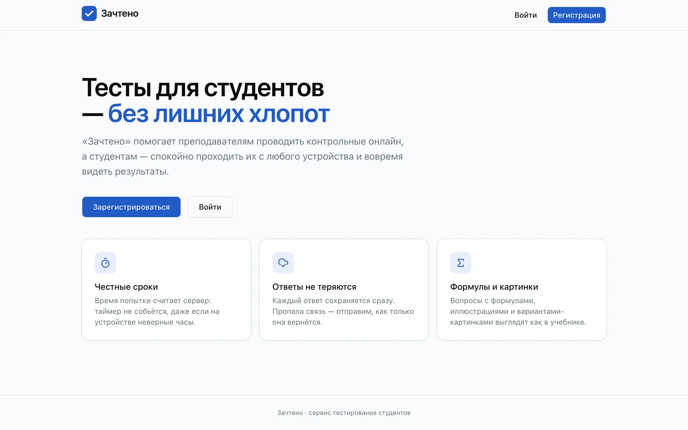
</picture>

</div>

## Для студента

Тесты приходят сами: студент вступает в поток по пригласительной ссылке и видит на своей панели всё, что открыто сейчас. Таймер считает сервер, каждый ответ сохраняется сразу, а пропавшая связь не теряет ответы: они уйдут, как только сеть вернётся.

<p align="center">
  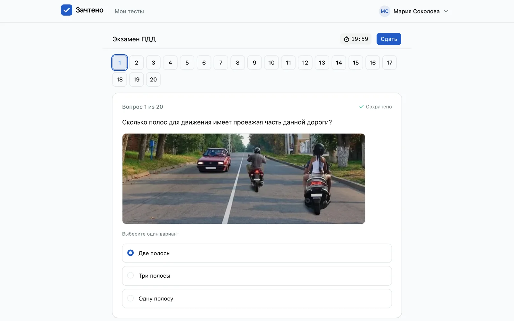
</p>

- **Вопросы** с одиночным и множественным выбором и со свободным ответом; картинки и формулы (KaTeX) в вопросах и в вариантах.
- **Свободная навигация**, если тест её разрешает: можно пропускать вопросы и возвращаться к ним, перед сдачей сервис напомнит о неотвеченных.
- **Разбор попытки** — сразу, после закрытия теста или никогда, как решит автор теста.

<table>
  <tr>
    <td align="center" valign="top">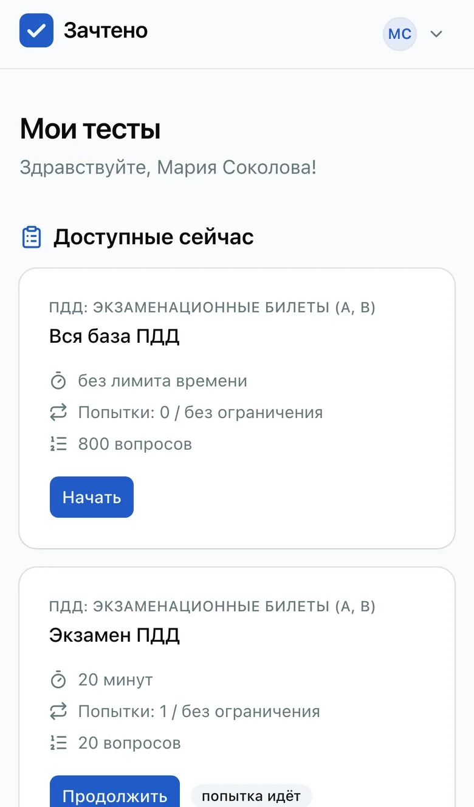<br><sub>Мои тесты</sub></td>
    <td align="center" valign="top">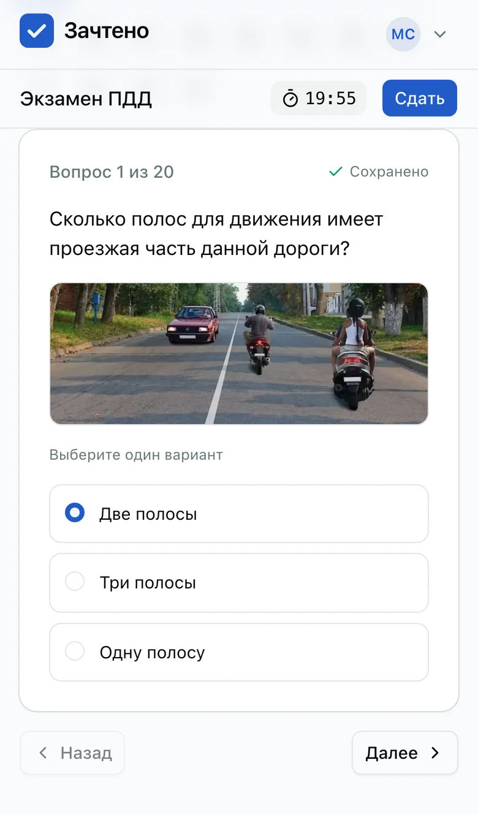<br><sub>Прохождение</sub></td>
    <td align="center" valign="top">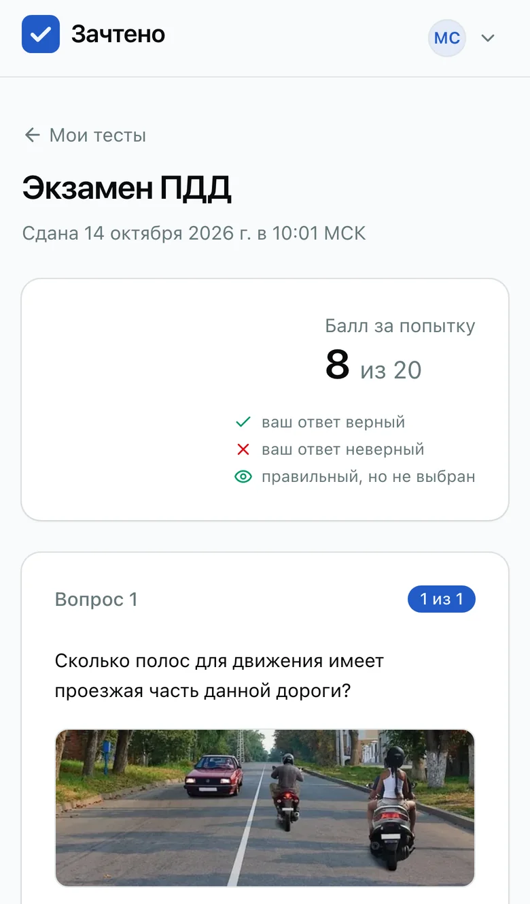<br><sub>Разбор попытки</sub></td>
  </tr>
</table>

<details>
<summary>Ещё экраны студента</summary>

<br>

| Приглашение в поток | Перед началом теста |
|---|---|
| 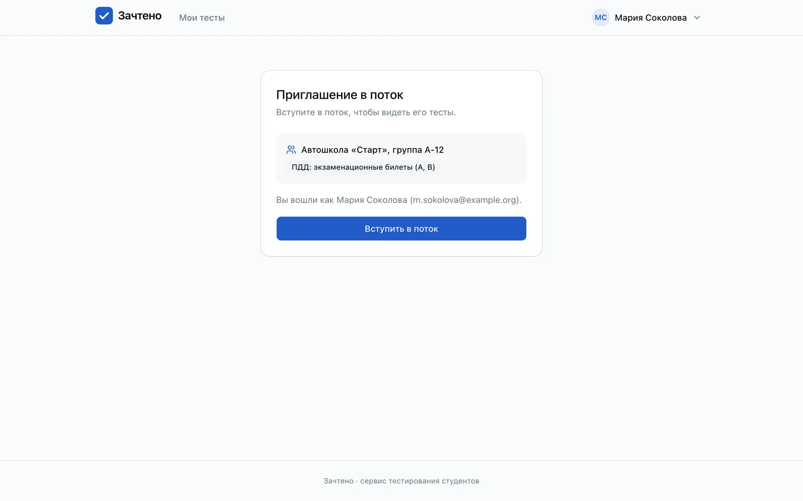 | 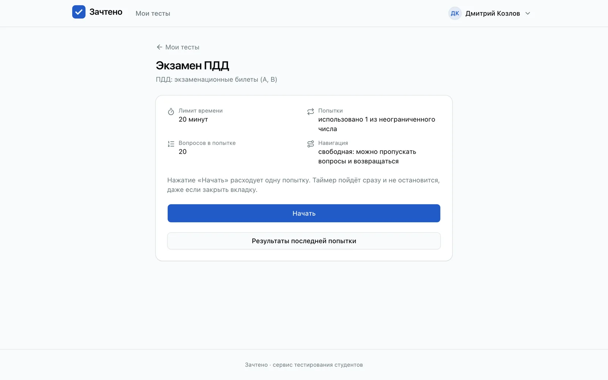 |

| Панель студента | Разбор попытки |
|---|---|
| 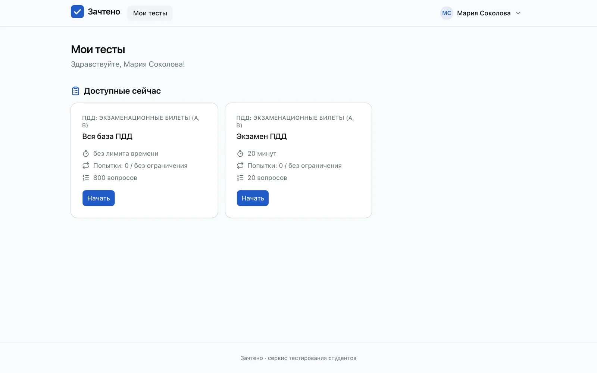 | 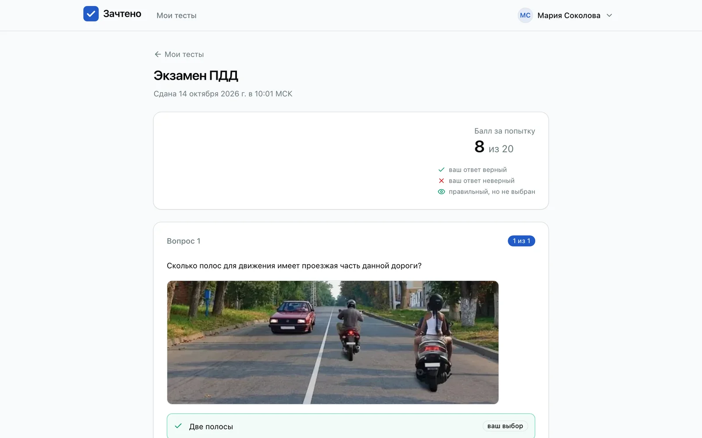 |

</details>

## Для методиста

Курс — набор тестов, тест — набор вопросов. Курсы и тесты можно копировать; тест нельзя изменить после первого ответа студента, чтобы результаты оставались сравнимыми.

<p align="center">
  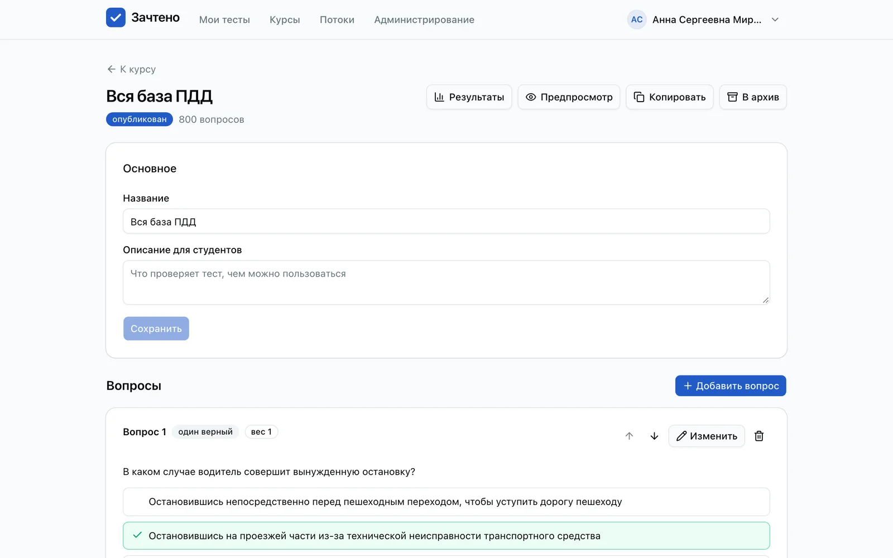
</p>

- **Оценивание:** вес вопроса (по умолчанию 1); для множественного выбора — режимы «только все», «хотя бы один», «балл за каждый верный» и «доля верных»; штрафы за неверные варианты; процент от максимума у студента и в отчётах.
- **Настройки теста:** лимит попыток и времени, число случайных вопросов в попытке, перемешивание вопросов и вариантов с закреплением позиции, какая попытка идёт в итог — лучшая, последняя или средняя, запрет копирования текста вопросов.
- **Преподаватели курса** видят тесты и результаты, управляют потоками и окнами, но не меняют тесты.

## Для преподавателя

Потоки — группы студентов. Курс назначается потоку, тесты открываются и закрываются для всего потока сразу: вручную или по расписанию (время московское).

<p align="center">
  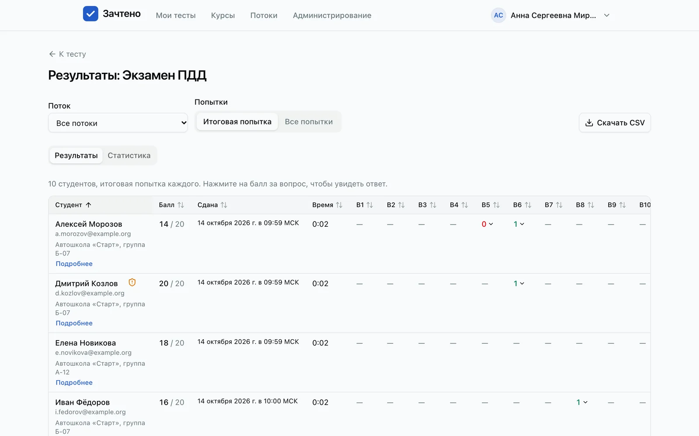
</p>

- **Результаты** по каждому тесту: фильтр по потоку, сортировка, балл по каждому вопросу и разбор ответа по щелчку, выгрузка в Excel (листы с баллами, ответами и текстами вопросов) и в CSV.
- **Сводная таблица курса** — итоговые баллы студентов по всем тестам.
- **Пригласительные ссылки** с журналом: кто и когда вступил.

| Сводная таблица курса | Поток и его участники |
|---|---|
| 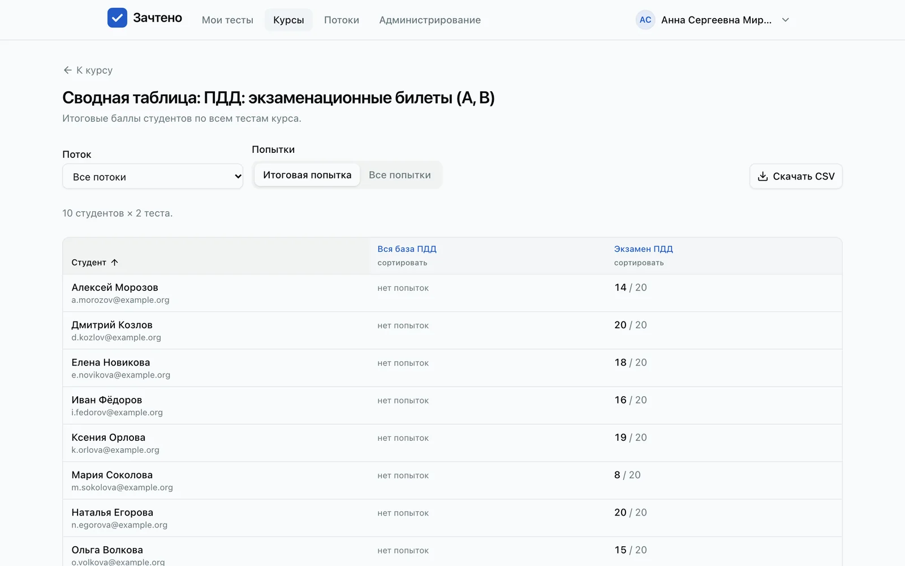 | 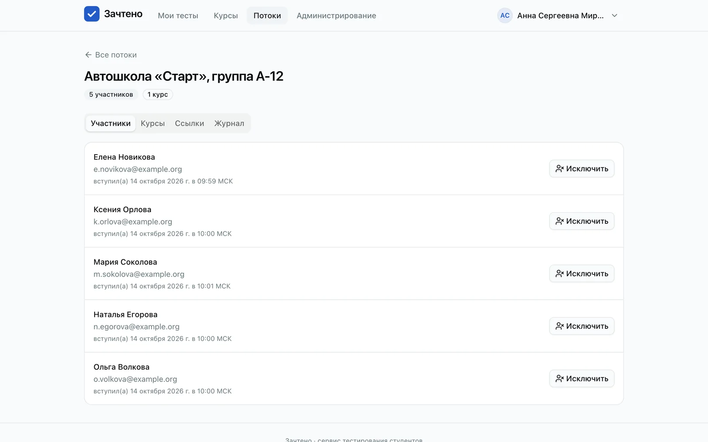 |

<p align="center">
  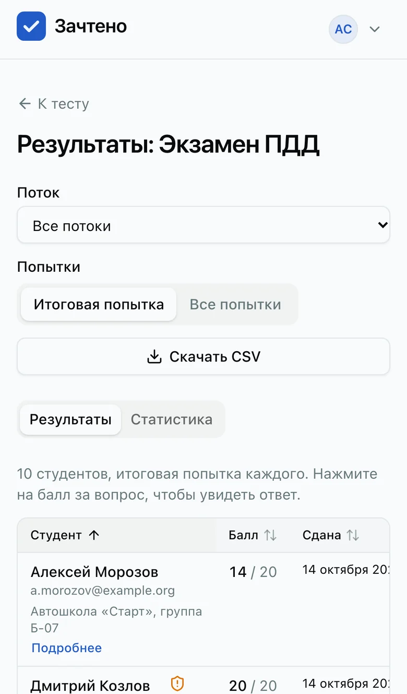<br>
  <sub>Результаты открываются и с телефона</sub>
</p>

## Связанные аккаунты

Сервис собирает сигналы браузера, устройства и сети и подсказывает, какие аккаунты могли проходить тесты вместе — в том числе после смены браузера или устройства. Это только сигнал: ничего не блокируется и не влияет на баллы, решение по каждой связи принимает преподаватель.

<p align="center">
  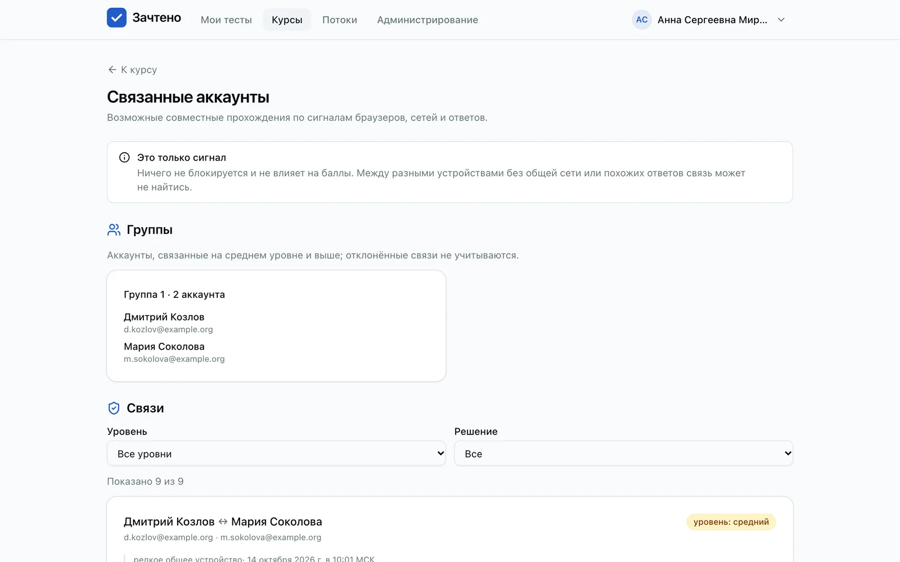
</p>

## Пример: экзамен ПДД

На стенде лежит курс «ПДД: экзаменационные билеты (A, B)» — 800 вопросов, 541 из них с картинкой:

- **«Экзамен ПДД»** — 20 случайных вопросов из всей базы и 20 минут, как на настоящем экзамене;
- **«Вся база ПДД»** — все 800 вопросов, без ограничения времени.

Вопросы загружаются командой `seed-pdd` из открытого набора [etspring/pdd_russia](https://github.com/etspring/pdd_russia). Скриншоты в этом README сняты на демо-стенде с этим курсом; студенты и их результаты вымышленные.

## Как устроено

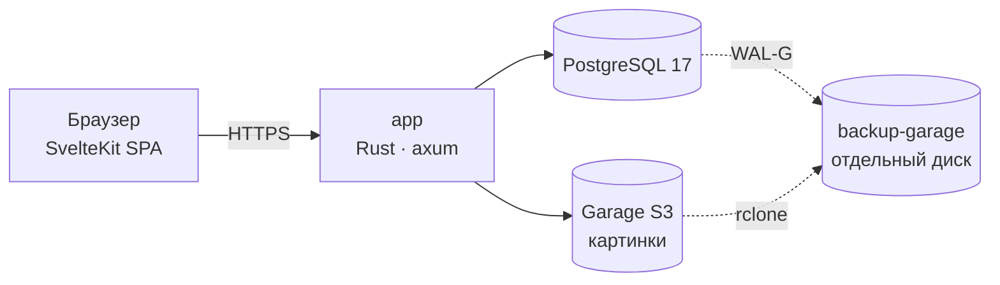

| Часть | Что внутри |
|---|---|
| **Бэкенд** | Rust: axum, sqlx, utoipa (OpenAPI), tokio |
| **Фронтенд** | SvelteKit 2 и Svelte 5, Tailwind, shadcn-svelte; статическая сборка, раздаётся бэкендом |
| **Данные** | PostgreSQL 17, картинки — в Garage (S3) |
| **Почта** | любой SMTP; письма подписаны DKIM, проверено на Яндексе и Gmail |
| **Вход** | email и пароль (Argon2id с солью и перцем) или Яндекс ID; роли — студент, преподаватель, методист, суперпользователь |
| **Бэкапы** | WAL-G с восстановлением на любой момент времени, копия бакета картинок, еженедельная проверка восстановления |
| **Проверки** | `just ci`: clippy, тесты бэкенда и фронтенда, актуальность OpenAPI-типов; сквозные тесты Playwright |

## Быстрый старт

Нужны Rust, Node.js 24, Docker и [`just`](https://github.com/casey/just).

```sh
cp .env.example .env    # секреты — по комментариям в файле
docker compose -f docker-compose.dev.yml up -d
# ключ и бакет Garage: значения S3_ACCESS_KEY_ID, S3_SECRET_ACCESS_KEY, S3_BUCKET из .env
deploy/garage/init.sh docker-compose.dev.yml garage <key-id> <key-secret> <bucket>
(cd frontend && npm ci)
just dev                # бэкенд и Vite с прокси /api
```

Первый суперпользователь (команда выведет ссылку для пароля) и демо-курс ПДД:

```sh
git clone https://github.com/etspring/pdd_russia ~/pdd_russia
set -a; . ./.env; set +a    # приложение читает окружение, а не файл
cd backend
cargo run -p app -- create-superuser --email you@example.org
cargo run -p app -- seed-pdd --dir ~/pdd_russia --owner you@example.org
```

Остальные команды — `just --list`.

## Документация

- [Требования](openspec/specs/) — действующие спецификации OpenSpec по областям; [дизайн и задачи](openspec/changes/archive/2026-10-14-add-student-testing-platform/) — изменение, по которому написан сервис.
- [Развёртывание через Docker Compose](deploy/compose/README.md) — production-конфигурация, бэкапы, таймеры systemd.
- [Восстановление из бэкапа](docs/ops/restore.md) — в том числе на момент времени и учебное восстановление.
- [Security-ревью](docs/security/review-2026-10.md) — найденное, исправленное и принятые риски.
